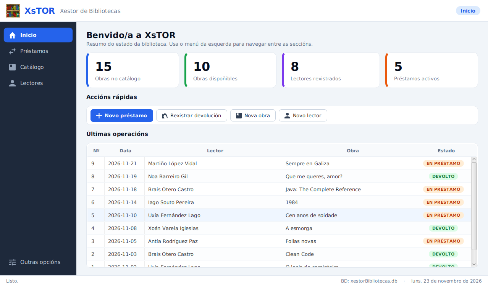

<p align="center">
  
</p>
<h1 align="center">XsTOR · Xestor de biblioteca (JavaFX)</h1>

Versión con interface gráfica JavaFX do proxecto trimestral de xestión de material bibliográfico,
o seu estado e os seus empréstitos. A base de datos segue sendo **SQLite** (`xestorBibliotecas.db`),
co mesmo esquema e os mesmos formatos de importación/exportación (CSV, JSON, TXT) e copia de
seguridade binaria que a versión de consola.



## Executar

```bash
mvn javafx:run                 # executar directamente
mvn package                    # xera target/xestorBibliotecaFX-2.0.0.jar
java -jar target/xestorBibliotecaFX-2.0.0.jar [ruta/da/base.db]
```

En Eclipse: *Import → Existing Maven Projects* e executar `Launcher.java`.
Require Java 17+.

## Estrutura

```
src/main/java/com/acarballeira/jdbc_sqlite/xestorBiblioteca/
├── Launcher.java              punto de entrada (JAR executable)
├── model/                     Obra, Lector, Operacion, ResultadoImportacion
├── dao/                       Database (conexión + esquema), CatalogoDAO, LectorDAO, PrestamoDAO
├── service/                   ImportExportService (CSV/JSON/TXT), BackupService
├── exceptions/                excepcións propias (as do proxecto orixinal)
└── ui/                        XestorApp, MainWindow, Dialogos, Iconas, UI
    └── views/                 PanelView, PrestamosView, CatalogoView, LectoresView, OpcionsView
src/main/resources/.../ui/     estilos.css, logo.jpg
exemplos/                      ficheiros CSV e JSON de proba
doc/                           Manual_de_uso_XsTOR.pdf e capturas
```

## Manual

>[!NOTE]
>Manual en desarrollo.

## Instalador para Windows (.exe)

Requisitos (en Windows): JDK 17+, Maven e [WiX Toolset 3.x](https://wixtoolset.org/) no `PATH`.

```bat
crear-instalador.bat
```

Xera `instalador\XsTOR-2.0.0.exe` (inclúe o JRE, non fai falta ter Java instalado), con
entrada no menú Inicio e acceso directo ao escritorio.

Unha vez instalada, a base de datos gárdase en `%APPDATA%\XsTOR\xestorBibliotecas.db`
(se hai un `xestorBibliotecas.db` no directorio de traballo na primeira execución, cópiase
alí). Pasar unha ruta como argumento segue funcionando para usar outra base de datos.
